<picture>
  <source media="(prefers-color-scheme: dark)" srcset="assets/banner-dark.svg?v=desk3">
  
</picture>

  

I'm a Founding Engineer and Technical Lead at [Symbl](https://symbl.health). I work directly with the founders, own the cloud platform underneath the product, and build internal products on top of it. Before that I was a Founding Engineer at [Prepare.sh](https://prepare.sh).

**[Portfolio and case studies: joshseq.com](https://joshseq.com)**

 

## Selected work

One set of Terraform modules builds roughly 7 to 8 AWS environments at Symbl, and releases ship through GitHub Actions to ECS in under six minutes.

| Project | What it is |
| --- | --- |
| [Operating the platform behind Symbl](https://joshseq.com/work/infrastructure-platform/) | AWS across 7 to 8 environments: Terraform, GitHub Actions to ECS/ECR, observability, networking, cost |
| [Rebuilding the developer environment stack](https://joshseq.com/work/developer-environments/) | Isolated learner environments moved from Azure AKS to bare-metal K3s |
| [Moving core infrastructure across cloud boundaries](https://joshseq.com/work/infrastructure-migration/) | CDN, object storage and databases moved from Azure to Cloudflare R2 and D1 |
| [Interactive AWS training platform](https://joshseq.com/work/aws-training-platform/) | LocalStack extended and wired into a custom frontend and backend |
| [Comparison tool](https://joshseq.com/work/comparison-tool/) | Internal tool that turns clinical recommendations into a customer-ready comparison |
| [WhatsApp operations dashboard](https://joshseq.com/work/whatsapp-dashboard/) | Open-source tool adapted into an internal WhatsApp operations dashboard |

## Stack I work in

- **Cloud:** AWS (ECS, ECR, EC2, RDS, IAM, Route 53, CloudWatch) · Azure · Cloudflare (Workers, R2, D1)
- **Infrastructure:** Terraform · Kubernetes and K3s · Helm · Docker
- **Delivery:** GitHub Actions · Jenkins · Azure DevOps
- **Observability:** Prometheus · Grafana · CloudWatch · Slack alerting
- **Web:** Astro · Tailwind · TypeScript · Go

## I also teach

I designed a hands-on AWS course around one evolving application, so learners re-architect the same app from a laptop process to a load-balanced, auto-scaled deployment instead of building 28 toy demos.

- [**taskflow-aws-cohort**](https://github.com/joshuasequeira19/taskflow-aws-cohort): 28 sessions, Console-first, from account safety to scaling and cost review
- [**taskflow-aws-capstones**](https://github.com/joshuasequeira19/taskflow-aws-capstones): four capstones that follow the course

## Get in touch

[joshseq.com](https://joshseq.com) · [LinkedIn](https://www.linkedin.com/in/joshua-sequeira-2b205965/) · joshua.sequeira2000@gmail.com

  

